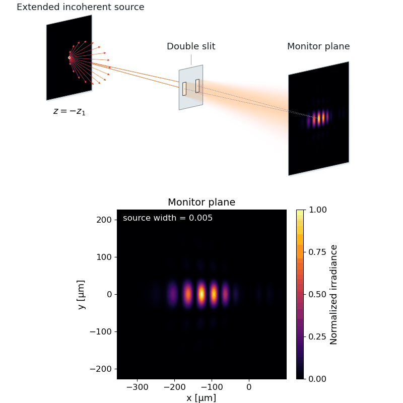
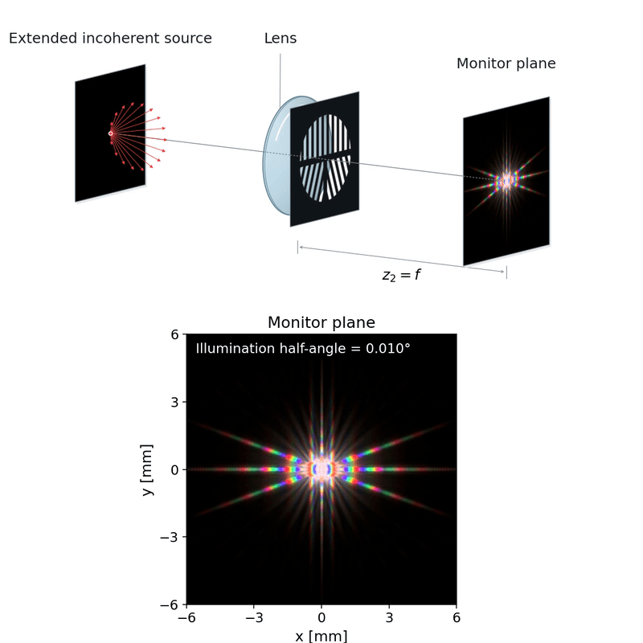
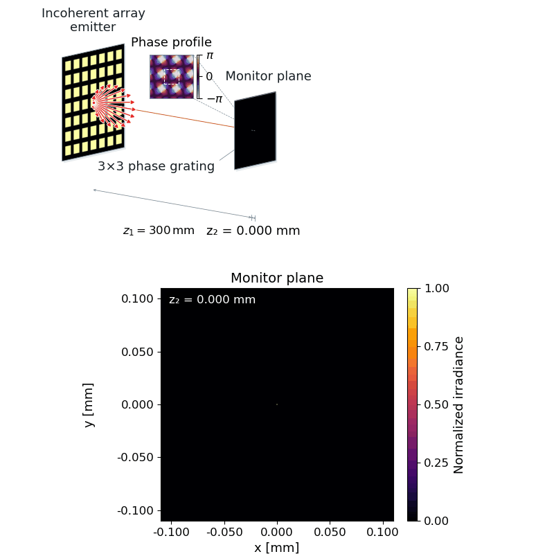
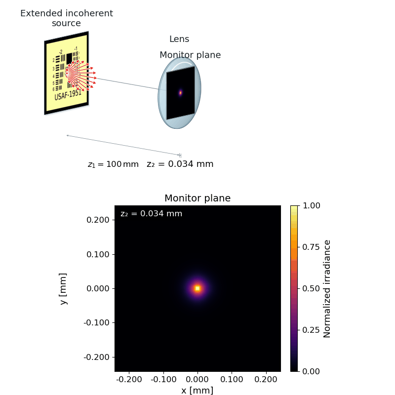
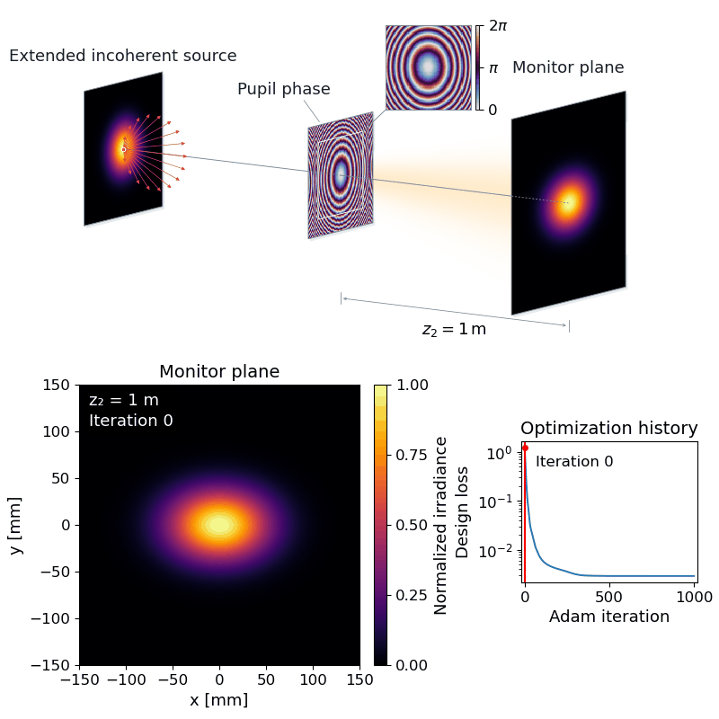
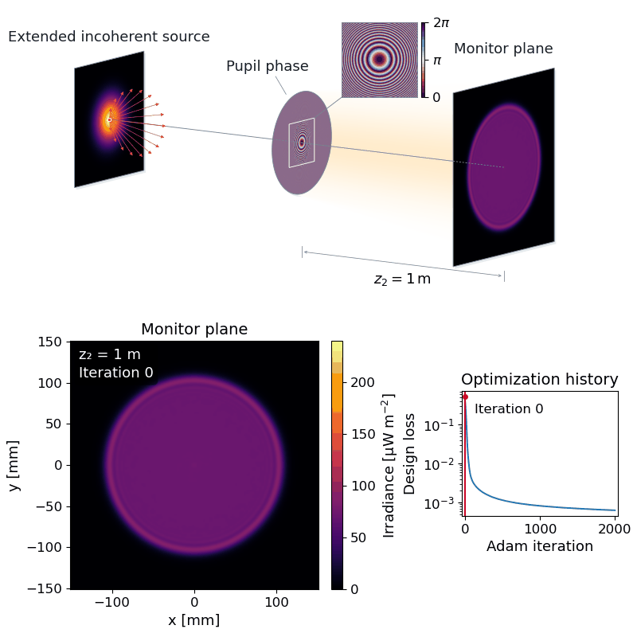
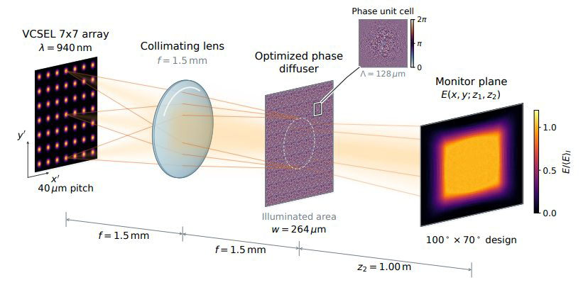
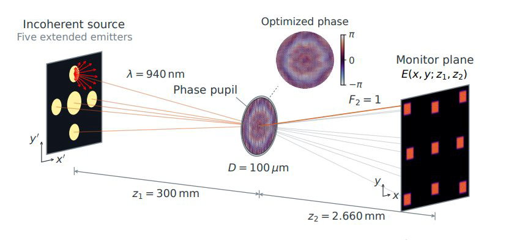

# Efficient convolution-based nonparaxial propagation of partially coherent light

`fast-incoherent-light-propagation` provides robust research code and example notebooks for fast, wide-angle diffraction and inverse design under extended incoherent illumination. It implements the method developed in the [accompanying paper](paper/Efficient_convolution_based_nonparaxial_propagation_of_partially_coherent_light.pdf).

The examples use simple **phase profiles and pupils** to keep the implementation simple, but these transmission models can be replaced by complex responses obtained from **full-wave electromagnetic simulations** such FDTD. 

The presented methods are fully differentiable with JAX backend. They can be used for **inverse design of metasurfaces, diffractive optics or SLMs for extended incoherent sources such as LEDs and thermal emitters**, enabling applications in **partially coherent holography, 3D sensing and efficient lighting**. 

## Aperture diffraction

|||
:--------------------:|:--------------------:|
`Double-slit diffraction with a spatially incoherent source.ipynb` | `Polychromatic diffraction with a spatially incoherent source.ipynb` |
[Link to the example](./Double-slit%20diffraction%20with%20a%20spatially%20incoherent%20source.ipynb) | [Link to the example](./Polychromatic%20diffraction%20with%20a%20spatially%20incoherent%20source.ipynb) |

Also included: [double-slit diffraction with a spatially incoherent source](./Double-slit%20diffraction%20with%20a%20spatially%20incoherent%20source.ipynb).

## Imaging examples

|||
:--------------------:|:--------------------:|
`Incoherent imaging with a 3 × 3 phase diffractive grating.ipynb` | `Incoherent lens imaging of a USAF source.ipynb` |
[Link to the example](./Incoherent%20imaging%20with%20a%203%20%C3%97%203%20phase%20diffractive%20grating.ipynb) | [Link to the example](./Incoherent%20lens%20imaging%20of%20a%20USAF%20source.ipynb) |

## Simple inverse design examples

|||
:--------------------:|:--------------------:|
`Simple flat-top inverse design with incoherent illumination.ipynb` | `Partially coherent holography with a GitHub-logo.ipynb` |
[Link to the example](./Simple%20flat-top%20inverse%20design%20with%20incoherent%20illumination.ipynb) | [Link to the example](./Partially%20coherent%20holography%20with%20a%20GitHub-logo.ipynb) |

## Paper inverse design examples

|||
:--------------------:|:--------------------:|
`Inverse design of a diffuser for a VCSEL array.ipynb` | `Inverse design of a 3 × 3 flat-top array with incoherent illumination.ipynb` |
[Link to the example](./Inverse%20design%20of%20a%20diffuser%20for%20a%20VCSEL%20array.ipynb) | [Link to the example](./Inverse%20design%20of%20a%203%20%C3%97%203%20flat-top%20array%20with%20incoherent%20illumination.ipynb) |

## Requirements

Use Python 3.11 or newer. From the downloaded or cloned project folder, install everything needed to run the notebooks with:

```bash
pip install -r requirements.txt
```

This installs the included `diffractsim` implementation, its dependencies, and JupyterLab. Run `jupyter lab` from the same folder to open the notebooks.

JAX runs on the CPU by default. For GPU support, follow the [JAX installation guide](https://docs.jax.dev/en/latest/installation.html).

## Main features

- Nonparaxial source–response convolution at finite distances and in the far field.
- Arbitrary extended source planes, angular illumination and polychromatic examples.
- Differentiability with JAX. The differentiability and the accuracy of the gradients for all methods have been verified using finite differences.
- Rayleigh–Sommerfeld references for checking the propagation approximations.
- As reported in the paper, complete forward evaluations are two orders of magnitude faster than traditional source-by-source angular-spectrum propagation at a common 1% relative irradiance-error tolerance.
- As reported in the paper, the implemented methods use **absolute radiometric normalization** enabling comparable computations and efficiency-aware design.

## Citation

If you use this code and/or method in your research, please cite the accompanying manuscript:

R. de la Fuente Herrezuelo, *Efficient convolution-based nonparaxial propagation of partially coherent light* (2026). [Paper](paper/Efficient_convolution_based_nonparaxial_propagation_of_partially_coherent_light.pdf) [BibTeX](paper/citation.bib).

Bibliographic metadata is also available in [CITATION.cff](CITATION.cff), which GitHub reads automatically.

This work builds on [Diffractsim](https://github.com/rafael-fuente/diffractsim).
